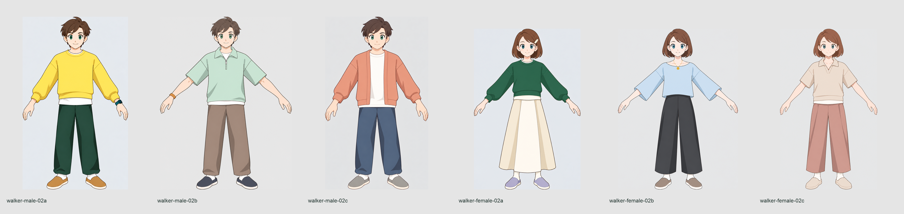

# 人物v2 頭身改稿 — Claude修正依頼 #167

本人が承認したのは絵柄のみという明示訂正に従い、6案を5.3〜5.8頭身へ改稿した。絵柄の基準は14:31承認4原図（head `1f1815e5`）。服・配色の系統・小物と物理的な左右位置を保持し、頭を大きく、脚と首を短め、手足をやや太めの相対体型へ変更した。胴は服が読める長さを維持。想定身長は男性172cm/女性160cm。

同じ枝とPR103で同ID/同ファイル名を差し替えた。前納品#143/head `e7fb1a30899e40aa35ae44fd0c1983eb567f494c` の6.5頭身版は[candidates/superseded-adult-issue143-20261014](candidates/superseded-adult-issue143-20261014)へ全45ファイルをバイト保持。#143のKanban/完了報告と旧Libraryを変更しない。今回の進捗は#167、完了hookは親が監査後に行う。3D・アプリ・ブラウザ・main push/merge/deployは実施していない。

正式単体18PNGは全て1254×1254の正式imagegen原出力とバイト一致。三面図6PNGは3120×1280、一覧5400×1280、顔比較1枚3600×1280。正式PNG計26枚＋色表6件。三面図/一覧/比較は切出し・等方配置とラベルのみで人物加筆なし。

## 実画素の頭身

髪を含む頭頂〜顎と頭頂〜足底を、原寸の正面・横12枚と完成三面図の正面・横12パネルで別に測った。座標/RGBと±1pxの境界不確かさを[final-inspection.json](final-inspection.json)へ記録。

| ID | 正面 頭頂/顎(x,y)/足底 | 正面 頭高/全高px・頭身 | 横 頭頂/顎(x,y)/足底 | 横 頭高/全高px・頭身 | 三面図 正面/横頭身 |
|---|---|---|---|---|---|
| walker-male-02a | 23/(618,246)/1225 | 223/1202・5.390135 | 14/(556,240)/1225 | 226/1211・5.358407 | 5.399103/5.351111 |
| walker-male-02b | 16/(618,232)/1225 | 216/1209・5.597222 | 5/(679,218)/1224 | 213/1219・5.723005 | 5.600000/5.733333 |
| walker-male-02c | 14/(618,242)/1226 | 228/1212・5.315789 | 12/(558,234)/1229 | 222/1217・5.481982 | 5.327434/5.472727 |
| walker-female-02a | 15/(618,227)/1223 | 212/1208・5.698113 | 15/(553,227)/1228 | 212/1213・5.721698 | 5.685279/5.714286 |
| walker-female-02b | 19/(617,229)/1228 | 210/1209・5.757143 | 21/(565,239)/1227 | 218/1206・5.532110 | 5.743590/5.544554 |
| walker-female-02c | 18/(623,229)/1228 | 211/1210・5.734597 | 10/(561,229)/1228 | 219/1218・5.561644 | 5.743590/5.572139 |

背面6枚も頭頂・足底と見える後頭部髪境界を実測した。顎は非可視なので顎座標/頭身はnull。髪境界を顎へ置き換えていない。隠れた顎の厳密な背面頭身はしていない。

一覧は6px/cm、男性1032px/女性960px、全員足底y1132。完成画素で12cm差を再走査。三面図は7px/cm、男性1204px/女性1120px、各方向足底y1230。列幅を広げ全指先を保持。正面袖y400/520の局所投影角は全て30〜45度で、隠れた肩関節角の厳密測定ではない。横は腕がカメラ方向に広がるAポーズの投影。

## 維持したものと修正

M-A黄色/深緑＋身体左時計、M-Bミント/トープ＋身体右腕輪、M-Cコーラル/青灰＋装飾なし。F-A緑/クリーム長スカート＋身体左髪留め、F-B青ボートネック/チャコール＋前胸金円盤（背は細チェーンのみ）、F-Cオートミールポロ/ローズ＋装飾なし。靴・靴下・白T裾の有無を保持。M-B横は右向き、他5案は左向き。

縦長の丸い目、穏やかな瞼、小さい鼻と口、柔らかい頬顎、まとまった髪、控えめな輪郭と簡潔なセル影を実表示で確認。[approved-face-comparison.png](approved-face-comparison.png)は同じ切出し座標・同縮尺のbefore/after。A/Bのbeforeは本人承認4原図、Cのbeforeは旧版（本人承認ではない）と明記した。

正式imagegen＋imagegen技能で当工程39回、採用18方向。[production-generations.json](production-generations.json)に全指示・入力スナップショットSHA・原出力SHA・採否を保存。作品/キャラ名を生成文章へ入れず、具体的人物・服・ロゴ・模様の複写指示なし。

正面6案を実測してから横背へ進んだ。頭の拡大不足/過大、袖角不足、女性Cの48度超を修正。旧横参照に引かれた6頭身超を直し、男性背面の頭部サイズも合わせた。女性C横5.907を追加修正。小幅編集で逆に頭身が戻った男性C試作は不採用にし、実測合格の原出力を復元した。不採用を正式枚数へ水増ししない。女性A靴下の色採取点が靴にかかったため1116へ修正し、全色値を現在の3×3中央値で保存。

18単体・6三面図・一覧・顔比較を実表示して検査。独立投影の手先/裾位置には数十pxの残差があり、同一3D投影とは主張しない。配色は部位/色系統を維持し、RGB値・AA・微小濃淡は画素ごとに完全同一ではない。数学的な全画素2色や背景完全均一ではない。

未実施：本人による今回の体型/姿勢の最終選択、背面の隠れた顎/骨格関節角、同一3D投影、素材物性、3D/rig/動き、アプリ/ブラウザ/実室内評価。

## 引渡しとLibrary

[handoff-manifest.json](handoff-manifest.json)は正式26PNG/6色表の32ファイルを列挙。[verify_deliverables.py](verify_deliverables.py)は実画素・寸法・原出力一致・姿勢・縮尺・履歴保持を確認する。変更はv2成果と台帳1行のみ。旧84PNGと停止3D89ファイルは保持確認だけで再制作していない。

Libraryの現行技能/補助ファイルが能力更新後に取得不能（cloud skill一覧なし、current helper fetch失敗）。古い補助や非公式保存は使用せず、今回のLibrary保存は未実施。親の指示に従い画像/PRを先に納品し、[レビューまとめ](candidates/proportion-issue167-20261014/issue167-review.png)の固定URLとMac原本名・寸法・SHAを返す。[review-image-manifest.json](review-image-manifest.json)、[library-save-status.json](library-save-status.json)に記録。旧#143 Libraryは履歴保持。

レビューまとめは5400×5884、上から新一覧・顔比較・三面図6案（左男性A/B/C、右女性A/B/C）。検査用合成で新しい案ではない。親が正式保存経路と元Claudeセッションへの完了報告を確認する。

[権利台帳](../../../../docs/legal/asset-sets-ledger.md)の公式OpenAI Content/Ownership・Similarity条件を継承。法/適用契約の許容範囲でのOutput帰属であり、独占性・第三者権利・非侵害・参照権利移転を保証しない。
