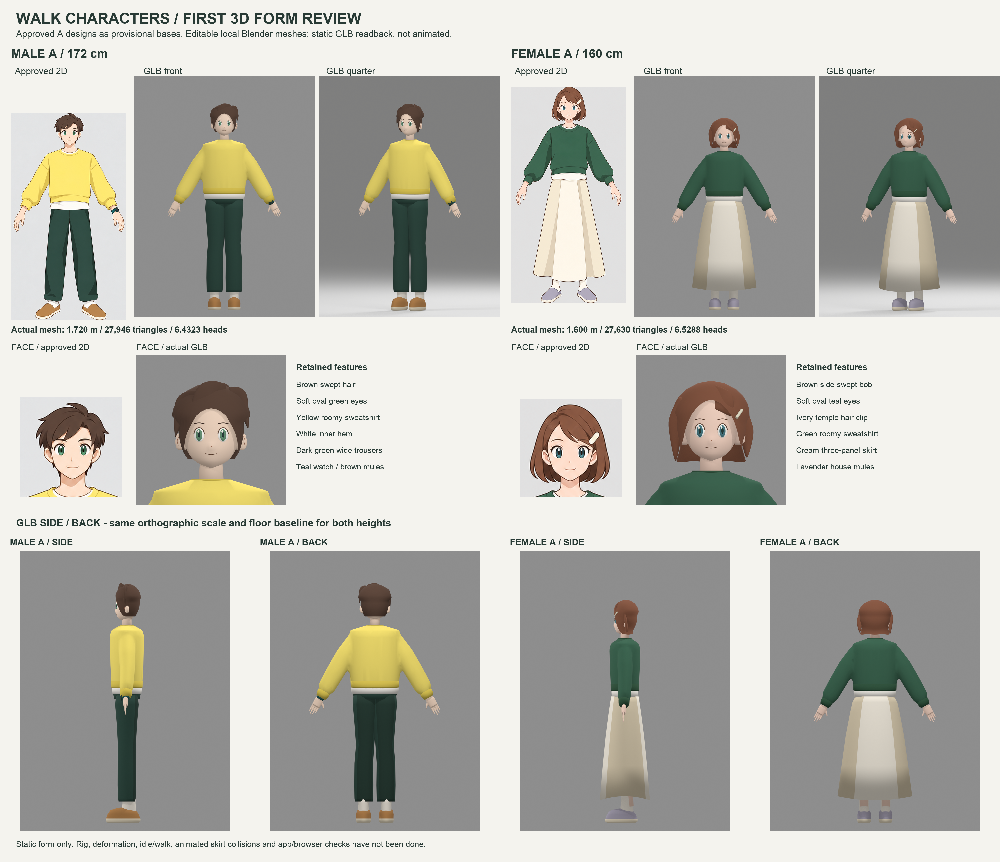

# 男女Aの初回3D形状レビュー

2026-10-14 14:31 JST、本人が「良いと思います。ではこれで3D進めましょう」と、head `1f1815e5ca7aca53d0893152e9f2926877c05c68` の最新4正面を承認した。新しい指示に基づくローカルBlender工程であり、訂正・取消された旧#135を再開したものではない。詳細は [phase-contract.json](phase-contract.json)。

男性A・女性Aを暫定ベースに制作。Bの2D原図も元PNGと `.blend` の非表示参照に保持し、最終服装をAに確定したわけではない。**今回の3D形状は本人レビュー待ち。歩行可能な完成モデルの納品ではない。** Draft PR103 / #143 InProgressを維持する。



主画像は4000×3450。[正面/斜め/横/背面/顔拡大](qa/reimport/) は、書き出した静止GLBそのものをBlenderに読み戻して描画した。全身は同じ2.01mの直交カメラ倍率・同じ足底位置で男女の12cm差を比較できる。2D欄は承認済み自作画像の参照で、3Dの代用ではない。PILの処理は切出し・等方拡縮・配置・文字のみで、人物の加筆や合成補修はない。[構成/入力SHA記録](qa/review-composition.json)。

## 編集元と独自制作方法

| 候補ID | 編集可能な元データ | 静止GLB | 残した特徴 |
|---|---|---|---|
| walker-male-home-a-preview | [男性 .blend](sources/walker-male-home-a-preview.blend) | [男性 GLB](models/walker-male-home-a-preview.glb) | 茶の流す髪、緑の丸い縦目、小さな閉口、黄色の厚いスウェット、白裾、深緑ワイド、画像右の時計、茶の室内ミュール |
| walker-female-home-a-preview | [女性 .blend](sources/walker-female-home-a-preview.blend) | [女性 GLB](models/walker-female-home-a-preview.glb) | 茶の横流しボブ、青緑の縦目、小さな閉口、白髪留め、緑スウェット、白裾、クリームの長スカート3面、薄紫ミュール |

[build_characters.py](build_characters.py) は独立した連続断面・曲面・スイープ形状の制作コード。頭部の頬/顎/鼻、顔面に沿う目/まぶた/眉/口、髪の面と大きな房、耳、連続する胴体/袖、手掌と5指、服の裾/カフ/襟厚み、スカートの内外殻、靴底/甲、小物を実メッシュで作った。球と箱を並べた人体の代用を完成扱いしていない。Body / Face / Hair / Clothing / Accessoriesを別の編集可能なコレクションに分け、服の材質/形状を交換できる構成にした。

`.blend` はメートル、Blender −Y正面/+Z上。GLBは +Z正面/+Y上。レンダー用の床・カメラ・ライトと、承認済み自作A/B画像の非表示参照はGLBへ出力しない。参照画素は元の2D成果物であり、外部の人物画像/モデルは取り込んでいない。Macの既存Blender 5.1.2で制作し、外部モデルサービス、Meshy、インストール、新認証、費用の発生、ブラウザ操作は行っていない。

## 実測と検査

| 項目 | 男性A | 女性A |
|---|---:|---:|
| GLB頂点からの全高m | 1.720000029 | 1.600000024 |
| GLB実三角形数 | 27,946 | 27,630 |
| GLB頭頂〜顎m | 0.267401338 | 0.245067239 |
| 頭身実測 | 6.432279 | 6.528821 |
| 床Y | 0 | 0 |
| テクスチャ / 骨 / 動き | 0 / 0 / なし | 0 / 0 / なし |

頭身はプロンプトや目測の値ではない。GLBのPOSITIONバイナリを読み、全ノード変換後の全身最大Y（見える髪頭頂）・頭部の最小Y（顎）・足底最小Yを実測して割った。2Dの比率を数値設定しただけで同一と主張せず、3D形状の実測差を記録する。旧5〜5.5頭身条件は本人の成人体型への変更後の履歴であり、今回に戻さない。

- [独立GLB検査](inspect_glb.py): ヘッダー/長さ、実インデックス、全頂点/法線/UVの有限値、3万三角形以下、床原点/両足間、目の位置による+Z正面、材質、テクスチャ/skin/動きなし、ステージ/参照の非混入を確認。
- [読戻し検査](validate_reimport.py): GLBを新規Blenderシーンに読み込み、原シーンと全高/三角形数一致。ゼロ面積面・孤立頂点とも0。UV/材質境界で分かれるGLBの境界辺数も記録し、完全な閉メッシュ・アニメ用トポロジーの認証とは扱わない。髪には頭部に接する意図的な開いた髪際、人体/服には部品の重なりがある。
- 女性の静止スカートと左右の脚/靴下は、BVH候補抽出と実辺〜三角形交差を確認し、4部品とも交差0。歩行時の干渉や布シミュレーションは検査していない。
- 制作中のSource画像と、最終GLB読戻し10ビューを並べた完成レビュー画像を実表示し、全身/顔/髪/衣服/靴/小物/方向を確認。材質HEXは各JSONに保存。3D照明による陰影があるため、レンダー画素が2Dの平面色と完全一致するとは主張しない。白インナー/靴下は共通の暖白材質で、2Dの光/影サンプルと小さな色差がある。
- 全84枚の既存v2 PNGは承認基準head `1f1815e5` と完全バイト一致。既存アプリ・既存モデル・原依頼書・本番は変更していない。

## 修正履歴と残る差

[iterations](qa/iterations/) に途中コード/実測/画像を残す。初稿は髪の底面が顔を覆う、肩が分離して角張る、女性が30,112三角形で予算超過したため不採用。髪の顔を覆う底面を外し、胴/袖を連続化、手掌/指を連続化して面数調整。目/耳/鼻/髪留めを下げ、髪房を曲線化、頭部輪郭と髪のドームを平滑化。最終で襟を25mm上げ首を短くし、肩を下げて滑らかにし、靴下を脚と交差しない形に修正した。

承認2Dは形の基準であり、同一投影の完全な立体復元ではない。髪の後方量感、ワイドパンツ腰の部品接合、袖/指の細部は初回形状レビュー段階。人体下衣内側や手の関節に、最終変形用の一体トポロジー/支持ループを用意済みとは主張しない。**rig・変形ウェイト・idle/walk/sit・歩幅/周期・その場歩行/足接地・歩行スカート干渉・three.js/アプリ/ブラウザ/実機検査は未実施。** 元#135の最終完成条件は満たしていない。

## 再生成

リポジトリrootから同じMacの既存Blenderで実行する。頭部/衣服コード、参照画像、レンダー設定は全て保存済み。

```sh
/Applications/Blender.app/Contents/MacOS/Blender --background --factory-startup -t 6 --python-exit-code 1 --python tools/characters/modeling/approved-20261014/build_characters.py
/usr/bin/python3 tools/characters/modeling/approved-20261014/inspect_glb.py
/Applications/Blender.app/Contents/MacOS/Blender --background --factory-startup -t 6 --python-exit-code 1 --python tools/characters/modeling/approved-20261014/validate_reimport.py
/usr/bin/python3 tools/characters/modeling/approved-20261014/compose_review.py
```

このMacではBlenderのMetal初期化が通常sandbox内で異常終了するため、本人承認済みのローカル制作範囲に対する実行審査を通したCLIで実施した。同じMac/同じSol6.1であり、新しい認証・環境切替ではない。混雑/通信中断後は、実行中プロセスと正常終了ログ・保存ファイルを読取確認して重複を避けた。

## 正式Library

主レビュー `first-3d-review.png` を同じMac実ファイルから正式手順で新規保存。`library_file_id`: **libfile_6124b534e71c8191ae31688d80a97c4d**、`file_id`: `file_00000000e3fc81f6bb24296b295fa209`。旧2D Library成果を保持。[保存/照合記録](qa/library-save-status.json)。

本PRは本人の初回3D形状レビュー待ちとしてDraftを維持する。Ready/Done/Claude完了報告、main push/merge/deploy、本番組込みは行わない。
